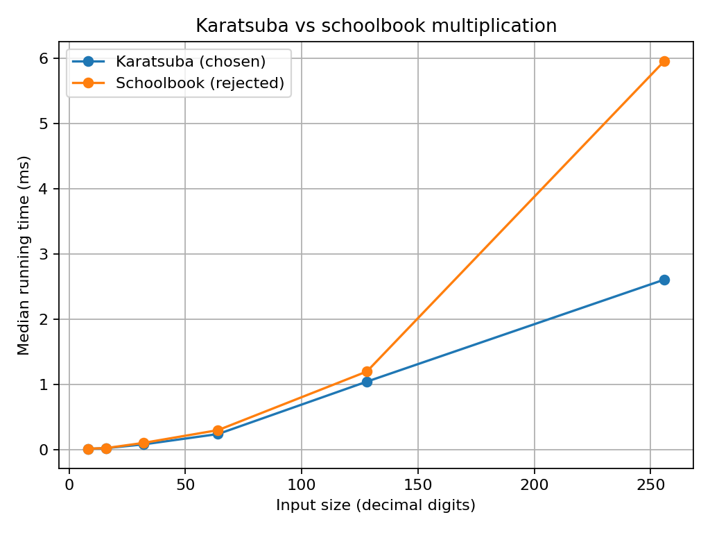

# Batch 9 — Large-number multiplication in a Hardware Security Module (HSM)

## Submission files

- `README.md`: report and result discussion
- `slides.pdf` and `slides.pptx`: presentation in PDF and editable formats
- `analysis_sheet.pdf`: supplied analysis sheet
- `code/`: runnable Python learning implementation, rejected alternative, input generator and benchmark script
- `results/timing.csv` and `results/timing_plot.png`: generated by the included Python benchmark
- `contributions/`: assigned contribution checklist and member-specific work files


## Team and contribution plan

| Roll No. | Name | GitHub username | Assigned part (20% each) |
| --- | --- | --- | --- |
| 24i301 | Abhinandhana | `abhinandhanar25` | Complexity analysis, recurrence, worst-case input and security caveats |
| 24i317 | Guruvarshana | `Guruvarshanaa-Vasanthakumar` | Karatsuba algorithm, worked trace and correctness proof |
| 24i334 | Nivarthna | `Nivarthna` | Introduction, problem modelling, constraints and data-structure comparison |
| 24i44 | Pravesha | `Pravesha06` | Implementation validation, benchmark methodology, result analysis and limitations |
| 24i376 | Sharmisthaa | `sharmisthaa30` | Design-technique choice, rejected techniques, repository setup and final integration |

This is the planned division of work. Each person must verify and complete their assigned section and make their own meaningful commit from their own GitHub account. Update this table if the actual work differs; do not claim work that was not done.

--- | --- | --- | --- | --- |
| [add roll no.] | Nivarthna | [add GitHub username] | Introduction, problem modelling, data structures | Drafted/intended contribution: problem definition, constraints and data-structure comparison. Confirm and edit to reflect actual work. |
| [add roll no.] | Sharmistha | [add GitHub username] | Design technique and rejected techniques | Drafted/intended contribution: divide-and-conquer explanation and comparison of rejected techniques. Confirm and edit to reflect actual work. |
| [add roll no.] | Guru | [add GitHub username] | Algorithm and trace | Drafted/intended contribution: Karatsuba pseudocode and worked trace. Confirm and edit to reflect actual work. |
| [add roll no.] | Abhi | [add GitHub username] | Complexity, constant-time considerations and worst case | Drafted/intended contribution: complexity and worst-case discussion. Confirm and edit to reflect actual work. |
| [add roll no.] | Pravesha | [add GitHub username] | Correctness, implementation, results and conclusion | Drafted/intended contribution: correctness argument, experimental analysis and conclusion. Confirm and edit to reflect actual work. |

> Replace every bracketed placeholder. The contribution table must describe each member's actual work; do not claim work that a member did not perform. Each member should make their own meaningful commit from their own GitHub account.

## Presentation

- **Recorded video:** [Watch the Batch 9 presentation on Google Drive](https://drive.google.com/file/d/1FsxJFgREwdcexenaXr_8WA6CK4jb_WHC/view?usp=sharing)
- Before submission, set Drive access to **Anyone with the link can view** and test the link in a private/incognito window.
- Required duration: at most 12 minutes; every member must present their own part.
- Slides PDF: [slides.pdf](slides.pdf)
- Editable slide deck: [slides.pptx](slides.pptx)

---

## 1. Problem modelling

- **Input:** Two non-negative integers, X and Y, represented as fixed-width arrays of 64-bit limbs. The analysis considers 2048-bit and 4096-bit operands, and benchmarks larger sizes to study scaling.
- **Output:** The exact product P = X × Y.
- **Objective:** Reduce multiplication work while preserving exactness and considering memory usage and timing-side-channel risk.
- **Constraints stated in the scenario/materials:** 512 KiB RAM and a target of 3,000 RSA signatures per second. The current experiment measures multiplication only, not a complete RSA signing operation; therefore, it does not demonstrate that the throughput target is met.
- **Problem class:** Computation problem with an optimisation objective (minimise multiplication cost).
- **Classical problem:** Multiplication of large integers.

## 2. Data structure analysis

| Data structure | Key operation(s) and cost | Space | Behaviour at the scenario scale |
| --- | --- | --- | --- |
| Chosen: fixed-width array of 64-bit limbs | Indexed access O(1); addition/subtraction O(n); splitting by index O(1) for views or O(n) if copied | O(n) | Compact representation and efficient word-level arithmetic |
| Alternative 1: decimal-digit array | Indexed access O(1); arithmetic visits digits | O(n) digits | More digit operations than 64-bit limbs for the same integer |
| Alternative 2: linked list of limbs | Accessing a position can take O(n); pointer traversal for arithmetic | O(n) plus pointers | Pointer chasing and locating split points add overhead |

**Why the chosen structure wins:** A fixed-width limb array offers direct indexing, contiguous storage, and convenient splitting. The implementation must still carefully manage carries, buffer bounds and memory access.

Memoising sub-products within a single Karatsuba multiplication is not generally useful because the recursive products usually have different operands. Precomputed values in a larger cryptographic workflow may be reusable, but that is outside the multiplication benchmark.

## 3. Design technique identification

- **Technique chosen:** Divide and Conquer, using Karatsuba multiplication.
- **Property that makes it work:** Split the operands into high and low halves. Three half-size products are sufficient to reconstruct the full product.

Let X = aB^m + b and Y = cB^m + d. Compute z2 = ac, z0 = bd, and q = (a+b)(c+d). Then the middle term is z1 = q − z2 − z0 = ad + bc. Thus XY = z2 B^(2m) + z1 B^m + z0.

## 4. Why the other four techniques do not fit

| Technique | Why it is unsuitable here (evidence) |
| --- | --- |
| Greedy | The task is an exact arithmetic operation, not a sequence of locally chosen decisions. No greedy-choice property is needed to determine the product. |
| Dynamic Programming | The standard Karatsuba recursion does not expose a useful collection of repeated identical subproblems to cache. Its three products normally have different operands. |
| Backtracking | There are no candidate solutions to enumerate and no constraints to test along a search path. Enumerating alternatives would add work without helping compute the exact product. |
| Branch and Bound | There is no optimisation search tree of candidate products to prune. Every recursive multiplication contributes to the exact result. |

## 5. Algorithm

```text
KARATSUBA(X, Y):
    if operand size is below the chosen threshold:
        return SCHOOLBOOK(X, Y)

    split X into high part a and low part b
    split Y into high part c and low part d

    z2 = KARATSUBA(a, c)
    z0 = KARATSUBA(b, d)
    q  = KARATSUBA(a + b, c + d)
    z1 = q - z2 - z0

    return z2 * B^(2m) + z1 * B^m + z0
```

The provided Python reference implementation is for algorithm demonstration and reproducible benchmarking, not for production cryptography. Python execution is not constant-time and must not be used for secret RSA operands.

## 6. Proof of correctness

**Base case:** When the operands are small enough, schoolbook multiplication computes the exact product by summing each digit/limb product at its proper positional weight.

**Inductive step:** Assume recursive multiplication returns correct products for smaller operands. Splitting gives X = aB^m + b and Y = cB^m + d. The recursive calls correctly compute ac, bd and (a+b)(c+d). Since (a+b)(c+d) − ac − bd = ad + bc, the combination is:
acB^(2m) + (ad+bc)B^m + bd = (aB^m+b)(cB^m+d) = XY.
Therefore, the result is exact. The recursive operand size decreases, so the recursion terminates.

## 7. Trace on the given instance

For 5678 × 1234, use base B = 100:
- 5678 = 56 × 100 + 78
- 1234 = 12 × 100 + 34
- z2 = 56 × 12 = 672
- z0 = 78 × 34 = 2652
- q = (56 + 78)(12 + 34) = 134 × 46 = 6164
- z1 = q − z2 − z0 = 6164 − 672 − 2652 = 2840
- Product = 672 × 10000 + 2840 × 100 + 2652 = **7,006,652**

## 8. Complexity analysis

- **Recurrence:** T(n) = 3T(n/2) + Θ(n).
- **Time:** Θ(n^log₂3) ≈ Θ(n^1.585) for Karatsuba above the base-case threshold. Schoolbook multiplication is Θ(n²).
- **Best/worst/typical:** For the fixed-size recursive algorithm, the asymptotic count of recursive multiplication work is Θ(n^1.585); real execution time depends on operand size, threshold, compiler/runtime, hardware and memory effects.
- **Space:** Auxiliary space is O(n) for a well-managed implementation, with recursion stack and scratch buffers. Exact memory use depends on implementation.

## 9. Worst-case input

The supplied analysis identifies all-one limbs (X = Y = 2^4096 − 1) as a useful carry-stress input. Test zero, sparse, random and all-one operands. These cases are useful for correctness and performance comparisons, but a timing difference alone cannot prove or disprove constant-time behaviour.

## 10. Implementation and empirical analysis

- **Language and how to run:** See [code/RUN.md](code/RUN.md). The included reference implementation is Python; it is not the C implementation described in the supplied analysis sheet.
- **Input sizes:** The included Python benchmark uses six decimal-digit sizes (8, 16, 32, 64, 128 and 256) and writes `results/timing.csv`.
- **Plot:** 
- **Interpretation:** In the bundled run, Karatsuba was faster than the decimal schoolbook reference at all six tested sizes, with a larger gap at the largest tested size. These values are a reproducible Python demonstration on the machine that generated the CSV, not measurements from an HSM or the C implementation described in the analysis sheet. Re-run the benchmark on the submission machine before final submission.
- **Comparison:** The chosen algorithm is Karatsuba; the implemented rejected alternative is schoolbook multiplication.
- **Important reproducibility note:** Run the benchmark on the submission machine and use the generated CSV/plot. Do not present results generated on a different machine as if they came from the HSM. The separate `analysis_sheet.pdf` contains the analysis supplied with the project and discusses a C implementation/virtual-CPU measurements. That C source file was not present in the supplied ZIP, so the included Python benchmark is kept separate and must not be presented as the same experiment.

## 11. Changed requirement

If the implementation must satisfy a constant-time requirement, ordinary high-level or variable-length arithmetic is not sufficient evidence. The implementation must use fixed-width operands, avoid secret-dependent branches and memory addresses, and be reviewed with suitable constant-time analysis tools and compiler output. The Divide and Conquer mathematical identity remains applicable, but a production implementation needs a carefully audited constant-time design. The Python demonstration supplied here is not constant-time.

## 12. Answers to the remaining scenario questions

- **Can the 3,000-signatures-per-second target be claimed as achieved?** No. The provided experiment measures multiplication only. A complete RSA signing benchmark must include modular exponentiation, reduction, CRT if used, key handling and target hardware.
- **Can the RAM limit be claimed as satisfied?** The analysis sheet estimates scratch and stack usage for its described C implementation. Verify the actual implementation's stack and memory use before making a definitive claim.
- **Does the benchmark establish HSM performance?** No. It is a software benchmark on a shared virtual CPU, not a hardware security module.
- **Does similar timing establish constant-time security?** No. Timing measurements are only a preliminary check; use dedicated statistical tests and code/compiler inspection.

## 13. Real-world reference

OpenSSL's big-number arithmetic includes recursive multiplication routines and selects algorithms according to operand size. See the official [OpenSSL documentation](https://docs.openssl.org/) and source repository [OpenSSL on GitHub](https://github.com/openssl/openssl). This assignment implementation is a teaching/benchmark exercise and is not a replacement for a vetted cryptographic library.
